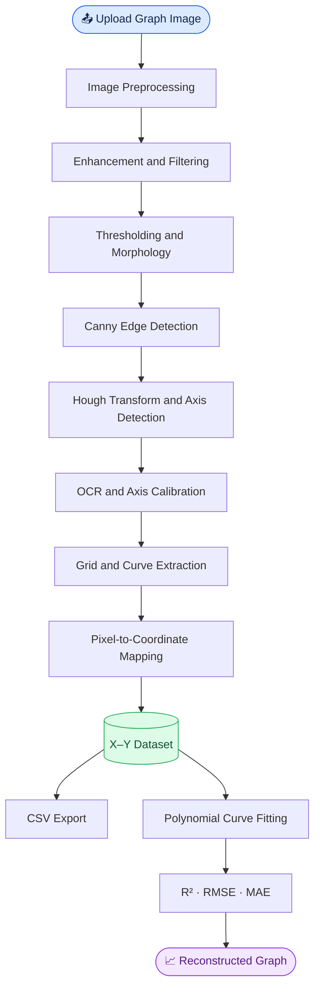
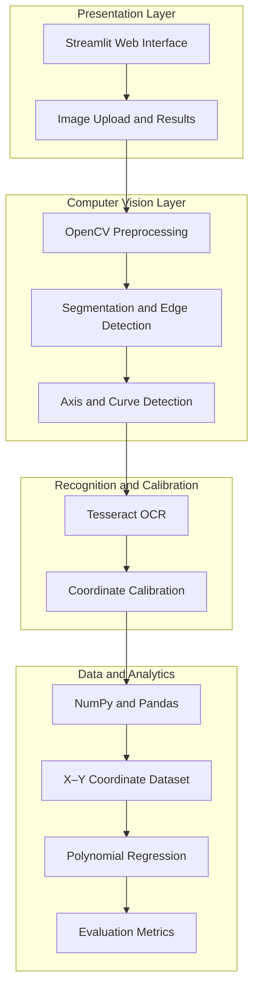
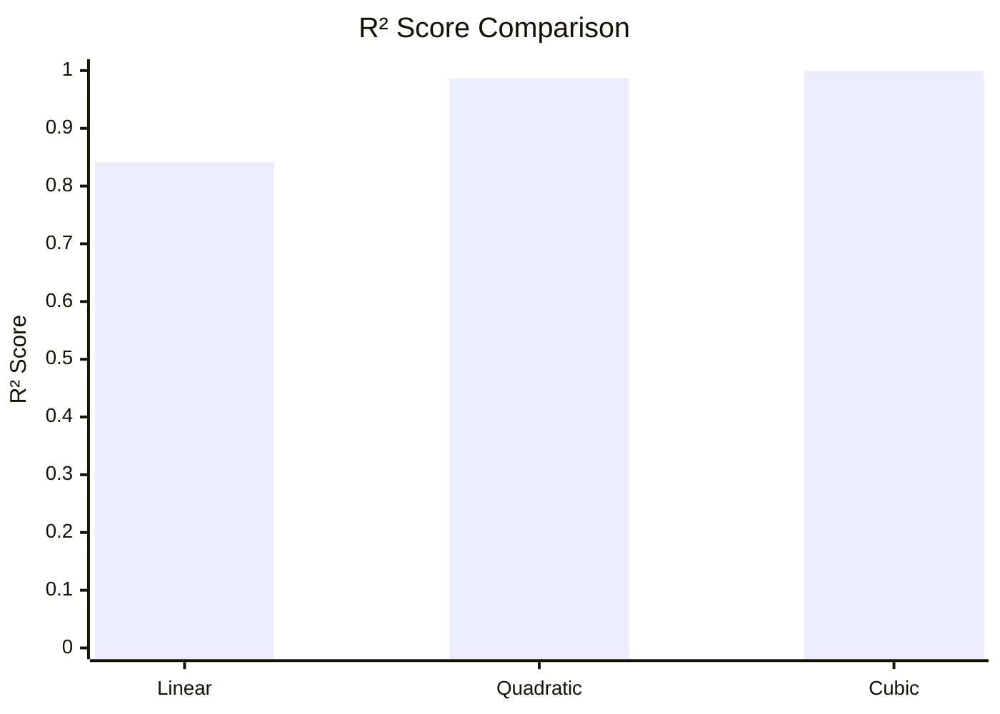

# 🔬 VisionPlot
### From Graph Images to Structured Data Using Computer Vision

<p align="center">
  <strong>Upload · Detect · Digitize · Analyze · Visualize</strong>
</p>

VisionPlot is a computer vision-powered graph digitization application that transforms graph images into numerical X–Y datasets using image processing, OCR, coordinate calibration, and polynomial curve fitting.

Instead of manually extracting points from plotted graphs, VisionPlot automates the process and generates structured data, reconstructed curves, and model evaluation metrics.

---

## 🖥️ Project Overview

| Feature | Description |
|---|---|
| Image Processing | Grayscale conversion, enhancement, and filtering |
| Graph Detection | Edge detection, thresholding, morphology, and Hough Transform |
| Text Recognition | OCR-based extraction of graph labels |
| Data Digitization | Pixel-to-coordinate mapping and X–Y extraction |
| Data Export | Download extracted coordinates as CSV |
| Curve Fitting | Linear, quadratic, and cubic polynomial models |
| Model Evaluation | R², RMSE, and MAE |
| Web Interface | Interactive Streamlit application |

---

## ⚙️ How VisionPlot Works



## 🏗️ System Architecture



## 🧠 Computer Vision Techniques

| Technique | Application |
|---|---|
| Grayscale Conversion | Simplifies image representation |
| Histogram Equalization | Improves image contrast |
| Gamma Correction | Adjusts image brightness |
| Gaussian and Median Filtering | Reduces image noise |
| Sobel and Laplacian Filtering | Highlights image gradients and edges |
| Unsharp Masking | Enhances image details |
| Thresholding | Separates graph elements from the background |
| Morphological Operations | Refines segmented image regions |
| Canny Edge Detection | Detects prominent boundaries |
| Hough Transform | Identifies straight lines and graph axes |
| Tesseract OCR | Recognizes graph labels and numerical text |
| Coordinate Calibration | Maps pixel locations to graph coordinates |

## 📊 Curve Fitting and Analysis

VisionPlot fits mathematical models to extracted coordinate data.

**Linear regression**

\[
y=ax+b
\]

**Quadratic regression**

\[
y=ax^2+bx+c
\]

**Cubic regression**

\[
y=ax^3+bx^2+cx+d
\]

The models can be evaluated using the coefficient of determination and error metrics.

| Metric | Purpose |
|---|---|
| R² | Measures goodness of fit |
| RMSE | Penalizes larger prediction errors |
| MAE | Measures average absolute prediction error |

### Example Results

The following are sample results from project experiments; actual performance depends on the input graph and extracted points.

| Model | R² | RMSE | MAE |
|---|---:|---:|---:|
| Linear | 0.8411 | 0.5946 | 0.4975 |
| Quadratic | 0.9873 | 0.1679 | 0.1416 |
| Cubic | 0.9995 | 0.0343 | 0.0285 |

These results illustrate how higher-order polynomial models can better represent curved data when the underlying curve has a suitable polynomial shape.

## 📈 Model Comparison



*The chart compares the sample R² scores listed above.*

## 🛠️ Technology Stack

<p>
  <strong>Core Language:</strong> Python
</p>

| Technology | Role |
|---|---|
| Python | Core application logic |
| OpenCV | Computer vision and image processing |
| NumPy | Numerical computations |
| Pandas | Data organization and CSV export |
| Tesseract OCR | Optical character recognition |
| Streamlit | Interactive web application |
| Matplotlib | Graph plotting and visualization |
| Scikit-learn | Regression evaluation metrics |

## 🚀 Getting Started

### Prerequisites

- Python 3.10
- pip
- Git
- Tesseract OCR

### 1. Clone the repository

```bash
git clone https://github.com/YOUR_USERNAME/VisionPlot.git
cd VisionPlot
```

### 2. Create a virtual environment

```bash
python -m venv .venv
```

Activate it on Windows:

```powershell
.venv\Scripts\activate
```

### 3. Install dependencies

```bash
pip install -r requirements.txt
```

### 4. Configure Tesseract OCR

Install Tesseract OCR and configure its executable path if it is not available through PATH.

Example Windows location:

```text
C:\Program Files\Tesseract-OCR\tesseract.exe
```

### 5. Run VisionPlot

If your Streamlit entry point is `VP/app.py`, run:

```bash
streamlit run VP/app.py
```

Open the local URL printed in your terminal.

## 📁 Project Workflow

```text
VisionPlot/
├── VP/
│   ├── app.py
│   └── ...
├── requirements.txt
├── README.md
└── .gitignore
```

*This is an illustrative structure. Adjust it to match your actual repository.*

## 🔮 Future Enhancements

- Multi-curve extraction from a single graph.
- Improved handling of logarithmic axes.
- Automatic legend and curve-color recognition.
- Better calibration for noisy or low-resolution images.
- Support for additional chart types.
- Improved OCR for rotated labels and complex plots.
- Web deployment for access without local installation.

## 👩‍💻 Contributor

**Trisha Shetty**

Computer Science and Engineering — Artificial Intelligence and Machine Learning

VisionPlot explores the practical application of computer vision, image processing, OCR, data extraction, and mathematical modeling in an integrated graph digitization system.

---

<p align="center">
  <strong>VISIONPLOT</strong><br>
  Turning pixels into data, one graph at a time.
</p>
